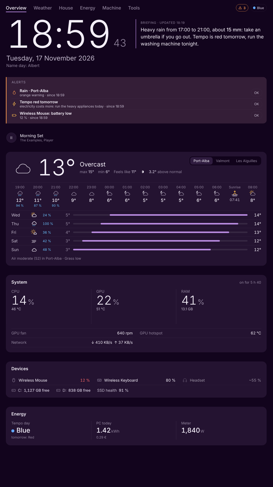
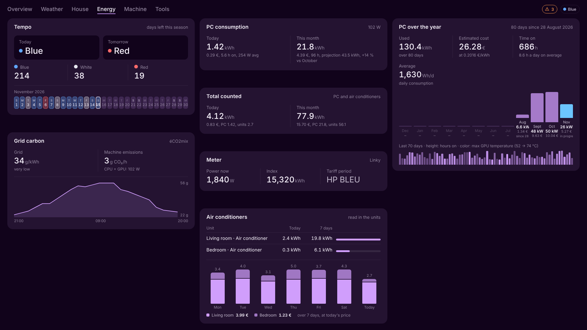
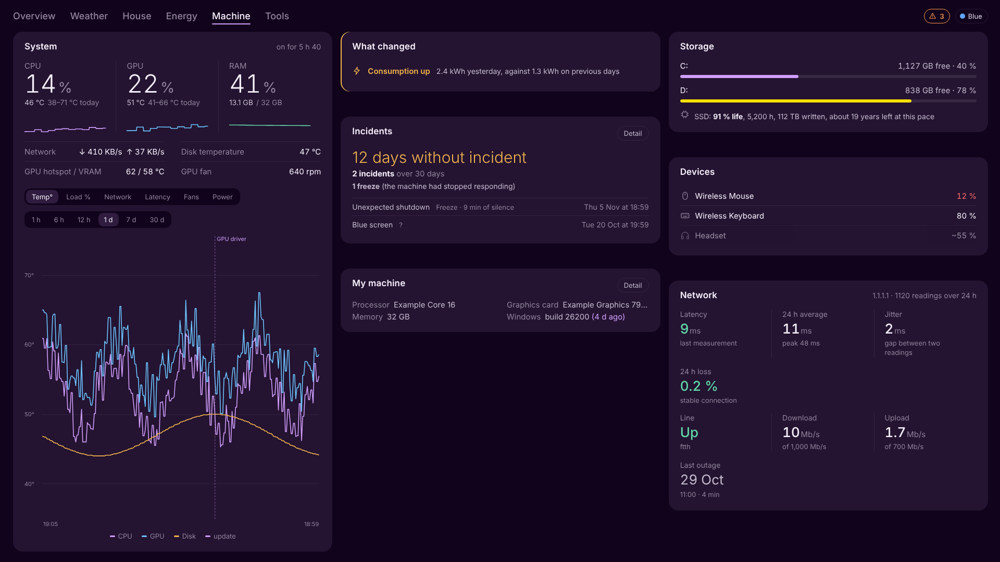
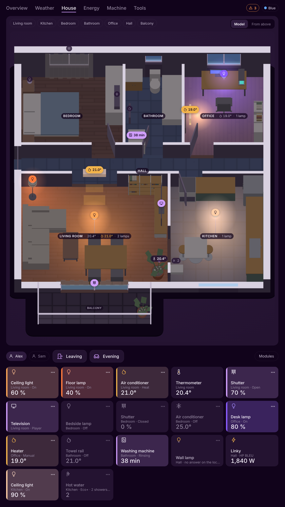
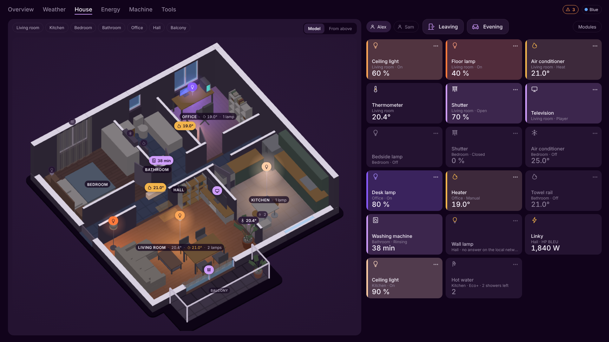
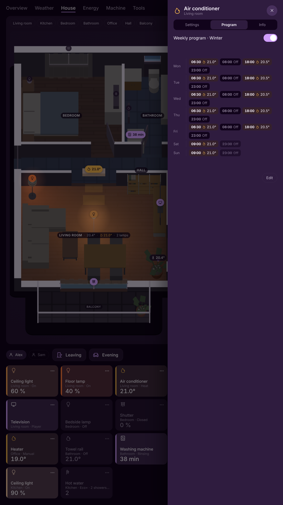

# Vigie

A dashboard for a vertical screen sitting next to your PC. It shows the weather, the state of the machine, its power use, and a few everyday things. Everything runs locally on Windows, with no account, no subscription and no npm dependency.

A small Node server reads the sensors and serves a plain HTML page. There is nothing to build and nothing to install besides Node.

<p align="center"></p>

The interface is available in English and French.

## What it shows

The interface has six tabs, and none of them ever scrolls: each one fits the screen it is on, upright or lying down, from a phone to a 1440p display. When a tab holds more than the screen can show, optional blocks give way, the others tighten, and what is left is split into sub-views you flip through with the dots, the arrow keys or a swipe. A list is never cut in the middle of a row. Detail panels follow the same rule, with their own inner tabs.

- **Overview**: the time beside the briefing, what needs you (weather warnings, a PC incident, a low battery, a device that stopped answering, each one can be acknowledged), today's weather with the coming hours and five days, the machine (CPU, GPU and RAM with temperature and their last hour, more when there is room), mouse and keyboard batteries with free space and SSD health, the home room by room with who is in and scene buttons, Tempo and the day's consumption. What is playing only shows while it plays.
- **Weather**: your cities, warnings, 48 hours as a curve (temperature, rain, wind), 7 days with their min/max band, air, pollen, UV and pressure on one page, snow depths when there is snow. The rain radar sits in the page on a screen with room for it, behind a button otherwise, and is only loaded when shown.
- **House**: your home room by room, with a 3D plan showing what is on, scenes in one tap, who is home, and the list of modules with their state.
- **Energy**: Tempo today and tomorrow with the days left per color and the month so far, the carbon intensity of the grid over 24 hours, what the PC used and cost, the total tracked (PC and air conditioners) for the day and the month, what each air conditioner used over 7 days (read from the unit itself) with its cost, the year in one strip.
- **Machine**: hardware sheet, what changed recently, incidents with a diagnosis, CPU/GPU/RAM with their history, storage and SSD health, batteries, connection quality.
- **Tools**: the versions that came out since your last visit, your links grouped by topic, the PC's own updates (GPU driver, BIOS, Windows), and fuel prices around home with the cheapest over 30 days.

<p align="center">
  
  
</p>

On the right of the tab bar, a pill counts the alerts in progress and another gives today's Tempo color. A night mode (`night` in the config) dims the screen and leaves the clock and the alerts; a touch brings everything back.

Optionally, a short briefing written by Claude sits next to the clock and sums up what deserves your attention, in the morning, at midday and in the late afternoon.

Weather warnings come from MeteoAlarm and work in 37 European countries, set with `country`. A few cards use French public data and only appear when `country` is `"FR"`: the EDF Tempo color and the days left, the grid's carbon intensity (éCO2mix), the regulated electricity price, the name day, public and school holidays, fuel prices.

## Requirements

- Windows 10 or 11
- [Node.js 22.13](https://nodejs.org) or later (for its built-in SQLite)
- [LibreHardwareMonitor](https://github.com/LibreHardwareMonitor/LibreHardwareMonitor/releases) for the sensors
- Google Chrome for the full screen mode (any browser is fine to try it out)

Optional:

- [LGSTrayBattery](https://github.com/andyvorld/LGSTrayBattery/releases) for the battery of Logitech wireless devices
- an Anthropic API key for the briefing
- Govee lights, Daikin units with a Wi-Fi adapter, an LG television, a Freebox: everything the House tab drives by default is driven over the local network, without an account

## Install

1. Clone the repository, then copy `config.example.json` to `config.json`.
2. Start LibreHardwareMonitor as administrator and enable **Options → Remote Web Server → Run** (port 8085). Check that `http://localhost:8085/data.json` answers.
3. Run `node agent.js` and open http://localhost:5252.

To get it full screen on the vertical display:

1. Run `powershell -ExecutionPolicy Bypass -File detect-monitors.ps1` to find the position of your screens.
2. Create a `start-dashboard.local.bat` file with your settings. Git ignores it, so updates won't overwrite it.

   ```bat
   set POS_X=1920
   set POS_Y=0
   set "LHM_PATH=C:\Tools\LibreHardwareMonitor\LibreHardwareMonitor.exe"
   ```

3. Double-click `start-dashboard.bat`. It starts LibreHardwareMonitor, the agent, then Chrome full screen on the right display. `stop-dashboard.bat` stops everything.

To start it at every login, double-click `install-startup.bat` once. Also enable **Run On Windows Startup** in LibreHardwareMonitor, otherwise it starts without admin rights and some sensors are missing.

When the folder is a git clone, `start-dashboard.bat` runs a `git pull` at every start.

## Configuration

Everything is set in `config.json`. Only the cities are really needed: any card whose settings are missing simply stays hidden.

| Key | What it does |
|---|---|
| `lang` | Interface language, `"en"` or `"fr"` |
| `country` | Two-letter country code (`"FR"`, `"DE"`, `"BE"`…) for weather warnings. `"FR"` also turns on the France-only cards |
| `cities` | Cities shown, the first one is the main city |
| `snowSpots` | Spots tracked for snow, with their altitude `alt` |
| `alertAreas` | Areas for MeteoAlarm warnings, with their exact name in the feed ("Rhône", "Isère") |
| `schoolZone` | French school holiday zone, `"A"`, `"B"` or `"C"`. Without it, only public holidays show |
| `network` | Target of the latency test (`1.1.1.1:443` by default) |
| `tools` | Link groups of the Tools tab. `icon` takes a name from `public/js/icons.js` (`code`, `chip`, `gamepad`…) or an emoji, `releases` lists GitHub repos whose latest version to track, each link `{ label, url, desc }` (`desc` optional, a short line shown when the tab has room) |
| `localVersions` | Path to an `.exe` to compare its installed version with the latest release |
| `electricity.pricePerKwh` | Your price per kWh. In France, left at `null`, Vigie uses the regulated tariff |
| `electricity.tempoPrices` | For a Tempo contract: `{ "blue": 0.13, "white": 0.16, "red": 0.75 }` |
| `electricity.baseWatts` | Watts to add to CPU + GPU for the rest of the machine |
| `fuel` | Fuel prices around the first city: `{ "types": ["e10", "sp98"], "radiusKm": 5 }`, among `gazole`, `sp95`, `e10`, `sp98`, `e85`, `gplc` |
| `anthropicApiKey` | Turns on the briefing |
| `briefing` | Optional tuning of the briefing, see below |
| `house` | Rooms, devices, ambiances and scenes of the House tab, see below |
| `theme` | Background color, the whole palette derives from it: `{ "color": "#0d3b66" }`. Add `"accent"` to pick the highlight color yourself |
| `dimming` | Screen dimming: `{ "level": 0.45 }` all the time, or `{ "level": 0.45, "from": "22:00", "to": "06:30" }` at night. No key, no dimming |
| `night` | Night mode: `{ "from": "23:30", "to": "06:30" }`. Between the two, a dark veil and an Overview reduced to the clock and the alerts. A click, a key or a touch wakes the screen for three minutes |
| `alerts` | Thresholds of the alerts, each optional: `batteryPct` (20), `diskFreePct` (8), `ssdLifePct` (15), `unreachableMin` (10), `climateOn` (true) with `climateOnHours` (12) and `climateOnModes` (["cool", "dry", "fan"]) for an air conditioner on without a break in those modes, `awayClimate` (true) with `awayClimateHours` (2) for one running in any mode while nobody has been home that long (presence from the Freebox), `incidentHours` (24), `cpuTemp` (88), `gpuTemp` (95), `diskTemp` (70), `tempHoldMin` (1) |
| `port`, `lhmUrl`, `lgstrayUrl` | Ports and addresses of the local services |

The other colors (warnings, temperature scale) are in `public/style.css`.

### House

The House tab talks to a small service of its own (`house/`), started inside the agent. **Devices are driven over the local network only.** Each integration is a module, and the tab lists them with their state: *active*, *ready, no hardware* (written and tested, waiting for its settings, costing nothing meanwhile) or *off, account required*.

Local, no account:

- **Govee lights**, without key or cloud. Switch on **LAN Control** once per lamp in Govee Home (the lamp, then its settings). A lamp that stays silent says why in its panel, with the steps.
- **Daikin** air conditioners through their Wi-Fi adapter: mode, fan, vanes, target, powerful and eco modes, energy used, and the weekly program stored in the unit, which keeps running with the PC off. Reserve their IPs on your router.
- **LG televisions**, after one pairing on the screen (`node house/pair-tv.js <address>`): on and off, volume, input, application.
- **Freebox**, through the local Freebox OS API, after one authorization on the box itself (`node house/pair-freebox.js`): who is home (from the phones you name in the config), the connection, its rates and its last outage.
- **Somfy shutters** through the local API of a TaHoma Switch (`house.tahoma`): position, open, close, stop, "my". Ready, tested on simulated answers.
- **MQTT** (`house.mqtt`), for a Zigbee2MQTT bridge: room sensors, door and leak sensors, plugs with their power and the end of a cycle, pilot wire modules for electric heaters, a Linky meter. Ready, tested on simulated answers.

Optional, **account required**, off until you fill their settings:

- **Cozytouch** (Atlantic, Thermor, Sauter heaters and water heaters), `house.cozytouch`.
- **LG ThinQ** (washing machines), `house.lgThinq`.
- **Govee cloud fallback**, for a lamp that never answers on the LAN: `house.govee.cloudFallback` and an API key.

Nothing in the service runs on a schedule: programs stay in the devices, so they keep running when the PC is off. If one day the service runs on a machine that stays on, set `house.remote` (`{ "url": "http://that-machine:5253", "token": "…" }`) and the agent relays `/api/v1` to it instead of starting its own.

Describe your home under `house` in `config.json`, by room:

```json
"house": {
  "rooms": [
    { "id": "living", "name": "Living room", "devices": [
      { "id": "living-lamp", "name": "Lamp", "type": "light", "driver": "govee-lan", "device": "00:00:5E:00:53:01:00:01" },
      { "id": "living-ac", "name": "Air conditioner", "type": "climate", "driver": "daikin", "ip": "192.0.2.20" }
    ] }
  ],
  "ambiances": [{ "id": "warm", "name": "Warm", "brightness": 45, "colorTempK": 2700 }],
  "scenes": [{ "id": "leave", "name": "Leaving", "actions": [{ "type": "light", "set": { "on": false } }, { "type": "climate", "set": { "on": false } }] }]
}
```

Open `http://localhost:5252/api/v1/discovery` to get the `device` id of each lamp that answers on your network. Ambiances are your own light presets, they replace Govee's scenes. Scenes are buttons at the top of the tab, and each one also has a plain URL for a Stream Deck or a shortcut. Once everything answers here, the Govee Home and Daikin apps can be uninstalled: reinstall Govee Home only to add a new lamp.

#### Plan

<p align="center">
  
  
</p>

With a floor plan, the tab opens on a model of the home: a lit lamp warms the floor of its room with its color, air conditioners show their mode and their target, shutters hang at their height, and a room with a sensor is tinted when it is cold or warm. The daylight follows the real sun when the plan says where north is. Press a room to zoom on it, a device to open its panel. Under 720 px wide, or without WebGL, the same plan is drawn flat.

The plan is a JSON file of your own (rooms, walls, openings, furniture picked from a library of types, and one anchor per device), described in [house/API.md](house/API.md#plan). **Keep it outside this folder**: it is the layout of your home, and it must not end up in a fork or a pull request. Point to it from `config.json`:

```json
"house": { "planPath": "C:\\Users\\me\\Documents\\home\\plan.json" }
```

To try it without drawing yours, copy the `house` block of `house/demo/config.json` into `config.json` with `"planPath": "house/demo/plan.json"`: a made-up flat with made-up devices.

#### Weekly program of an air conditioner

<p align="center"></p>

The detail panel of a Daikin unit shows the weekly program stored in the unit and edits it: one block per entry (a time, on in a mode with its target, or off), up to six a day, a day copied to others in two taps. The program is saved into the unit itself, so it runs whether the PC is on or not.

The service can also run alone on a machine that stays on (`node house/server.js`), with a token. Its API, the full configuration and how to add a driver are in [house/API.md](house/API.md).

### Briefing

The briefing is rewritten three times a day, and right away when something new happens (a PC incident, rain coming, a weather warning, a new alert). Every key of `briefing` is optional:

| Key | Default | What it does |
|---|---|---|
| `slots` | `{ "morning": 5, "midday": 12, "evening": 17 }` | Hour each time slot starts at. Before `morning`, the night still counts as the evening before |
| `minIntervalMin` | `30` | Minimum minutes between two calls to the model |
| `maxPerDay` | `8` | Maximum calls to the model per day |
| `rainSoonPct` | `60` | Rain probability within the next 3 hours that triggers a new briefing |
| `rainHourPct` | `50` | Rain probability above which an hour is listed for the model |
| `gustKmh` | `50` | Gust speed above which an hour is listed for the model |
| `fuelDeltaEur` | `0.05` | Price change in € per litre, over up to 7 days, from which a fuel is mentioned |
| `acHeatAboveC` | `18` | Outdoor temperature above which a heating left on is pointed out |
| `acCoolBelowC` | `15` | Outdoor temperature below which a cooling left on is pointed out |
| `electricityGapPct` | `20` | Gap in % between the month's projection and the previous month from which electricity is mentioned |

## How it works

```
start-dashboard.bat ──▶ agent.js (http://localhost:5252)
                          ├─ serves the page in public/
                          ├─ reads LibreHardwareMonitor, PowerShell, the Windows event log
                          ├─ records the sensors every 30 s in vigie.db
                          ├─ runs the house service (lights, air conditioners, television, box)
                          └─ queries MeteoAlarm, Tempo, éCO2mix, GitHub, Claude
```

| Path | Content |
|---|---|
| `agent.js` | Entry point: config, routes, scheduled jobs |
| `lib/` | The agent's logic, one module per topic (sensors, energy, weather, crash…) |
| `house/` | The house service: its API, one driver per brand, the floor plan. Runs inside the agent or alone |
| `public/` | The page: `index.html`, `style.css`, and ES modules in `js/` (no build). `vendor/three/` is three.js, copied in for the plan |
| `scripts/` | `check-scroll.js` (opens every tab and panel at nine screen sizes and fails if anything scrolls), `perf.js` (30 s at rest on each tab, fails if the page works more than it should) and `shots.js` (the screenshots), all on made-up data in headless Chrome |
| `test/` | Tests, run with `node --test` |

The page calls Open-Meteo directly for the weather. Everything else goes through the agent, on the same origin.

The agent only listens on `127.0.0.1`. It only serves the files of `public/` (your config and keys are not reachable), and the routes that act on hardware check where the request comes from.

Measurements are stored in `vigie.db` (SQLite, built into Node). Raw samples are kept 30 days, and one summary per day is kept forever for the yearly view. The agent also writes one copy of it per day in `backups/` and keeps the last 7. They sit on the same disk: copy that folder elsewhere if you care about your history.

The reasons behind some choices (freeze or power cut diagnosis, how latency is computed, the Daikin and Govee API traps…) are explained in [docs/NOTES.md](docs/NOTES.md).

## Services used

Without a key: [Open-Meteo](https://open-meteo.com) (weather, air, pollen, snow), [RainViewer](https://www.rainviewer.com/api.html) and OpenStreetMap (radar), the GitHub API (versions), [MeteoAlarm](https://meteoalarm.org) (warnings). In France also [API Couleur Tempo](https://www.api-couleur-tempo.fr), [éCO2mix / ODRÉ](https://odre.opendatasoft.com), [open-dpe.fr](https://open-dpe.fr), [Nominis](https://nominis.cef.fr), the [public holidays](https://calendrier.api.gouv.fr) and [school calendar](https://data.education.gouv.fr) of the French government, and its [fuel prices](https://data.economie.gouv.fr).

Two external libraries: three.js, copied into `public/vendor/` for the plan, and [Leaflet](https://leafletjs.com) for the radar map, loaded from a CDN with an integrity check only when the radar is shown.

## Troubleshooting

- **"LibreHardwareMonitor unreachable"**: the Remote Web Server is not running. Check `http://localhost:8085/data.json`.
- **Some sensors are missing**: LibreHardwareMonitor must run as administrator. If you use NZXT CAM, it locks the NZXT pump and fans while it is open.
- **A mouse or keyboard battery is missing**: check that LGSTray is running (`http://localhost:12321/devices`) and wake the device up. A faded value with `~` is normal, it is the last known value of a sleeping device.
- **A Bluetooth controller or headset is missing**: Windows only reports the battery of standard Bluetooth devices that are connected.
- **No weather warning shown**: good news, nothing is active for your areas. Check that `country` is set and that `alertAreas` uses the exact names of the MeteoAlarm feed.
- **Errors**: run `node agent.js` in a terminal to see what a source or a device answers.
- **A Daikin unit stopped answering**: its IP probably changed. Reserve it on your router.
- **A Govee lamp says "no answer on the local network"**: it has no power (switched off at the wall), or LAN Control is off for it in Govee Home.

## Development

No dependency to install. `node --test` runs the tests, and GitHub Actions runs them on every push with a syntax check of every file. `GET /perf` on the agent tells what it costs: CPU and memory over time, and how long each job, source and route takes.

`node agent.js --demo` serves the page on made-up data (a made-up flat, made-up sensors, no network call): the screenshots of this README come from it. `node scripts/check-scroll.js` uses it to check that nothing scrolls, at every size and in every panel; it needs Chrome (`CHROME` names another binary). `node scripts/shots.js docs/tabs` redraws the screenshots. Comments explain why, not what, and every text shown on screen goes through the `I18N` dictionary in `public/js/i18n.js`, in both languages.

## License

[MIT](LICENSE)
