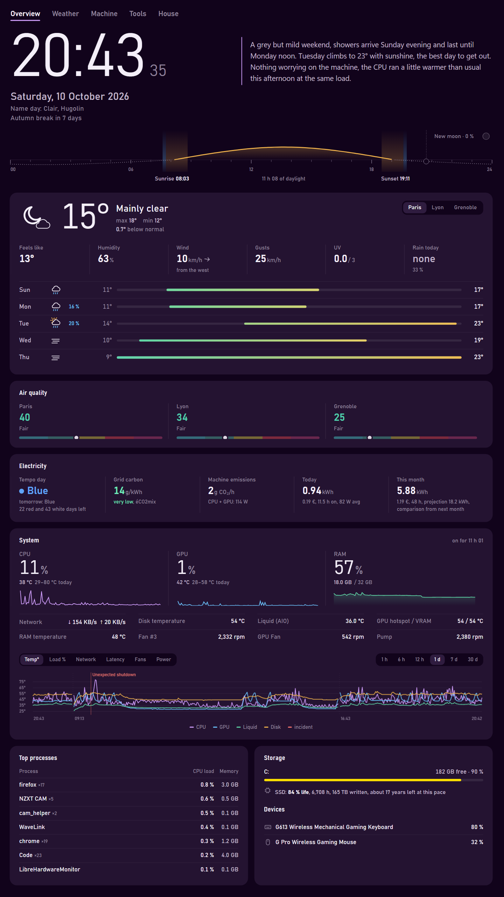

# Vigie

A dashboard for a vertical screen sitting next to your PC. It shows the weather, the state of the machine, its power use, and a few everyday things. Everything runs locally on Windows, with no account, no subscription and no npm dependency.

A small Node server reads the sensors and serves a plain HTML page. There is nothing to build and nothing to install besides Node.

<p align="center"></p>

The interface is available in English and French.

## What it shows

The interface has five tabs. The Overview is meant to be read at a glance and fits on one screen without scrolling, on a vertical screen as on a 1080p landscape one. The other tabs go into detail.

- **Overview**: time and the sun's path over the day with its golden and blue hours, today's weather and a 5 day forecast, air quality, electricity (machine consumption and cost), CPU/GPU/RAM with their last hour and a 30 day chart, top processes, storage, device batteries. What is playing shows up with a play/pause button, and pills appear only when something needs you: a restart, updates waiting, a service down.
- **Weather**: all your cities side by side, 48 hours hour by hour, pressure and its tendency, 7 days, animated rain radar, pollen, snow depth at a few spots.
- **Machine**: hardware sheet (drivers, BIOS, updates), what changed recently, crash history with a diagnosis, connection quality, the services you watch (router, NAS, websites), a yearly summary.
- **Tools**: your favorite links grouped by topic, and the latest versions of software you follow on GitHub.
- **House**: control of Govee lights and Daikin air conditioners, fuel prices around home.

Optionally, a short briefing written by Claude sits next to the clock and sums up what deserves your attention today.

Weather warnings come from MeteoAlarm and work in 37 European countries, set with `country`. A few cards use French public data and only appear when `country` is `"FR"`: the EDF Tempo color and the days left, the grid's carbon intensity (éCO2mix), the regulated electricity price, the name day, public and school holidays, fuel prices.

## Requirements

- Windows 10 or 11
- [Node.js 22.13](https://nodejs.org) or later (for its built-in SQLite)
- [LibreHardwareMonitor](https://github.com/LibreHardwareMonitor/LibreHardwareMonitor/releases) for the sensors
- Google Chrome for the full screen mode (any browser is fine to try it out)

Optional:

- [LGSTrayBattery](https://github.com/andyvorld/LGSTrayBattery/releases) for the battery of Logitech wireless devices
- an Anthropic API key for the briefing
- a Govee API key, and Daikin units with a WiFi adapter, for the House tab

## Install

1. Clone the repository, then copy `config.example.json` to `config.json`.
2. Start LibreHardwareMonitor as administrator and enable **Options → Remote Web Server → Run** (port 8085). Check that `http://localhost:8085/data.json` answers.
3. Run `node agent.js` and open http://localhost:5252.

To get it full screen on the vertical display:

1. Run `powershell -ExecutionPolicy Bypass -File detect-monitors.ps1` to find the position of your screens.
2. Create a `start-dashboard.local.bat` file with your settings. Git ignores it, so updates won't overwrite it.

   ```bat
   set POS_X=1920
   set POS_Y=0
   set "LHM_PATH=C:\Tools\LibreHardwareMonitor\LibreHardwareMonitor.exe"
   ```

3. Double-click `start-dashboard.bat`. It starts LibreHardwareMonitor, the agent, then Chrome full screen on the right display. `stop-dashboard.bat` stops everything.

To start it at every login, double-click `install-startup.bat` once. Also enable **Run On Windows Startup** in LibreHardwareMonitor, otherwise it starts without admin rights and some sensors are missing.

When the folder is a git clone, `start-dashboard.bat` runs a `git pull` at every start.

## Configuration

Everything is set in `config.json`. Only the cities are really needed: any card whose settings are missing simply stays hidden.

| Key | What it does |
|---|---|
| `lang` | Interface language, `"en"` or `"fr"` |
| `country` | Two-letter country code (`"FR"`, `"DE"`, `"BE"`…) for weather warnings. `"FR"` also turns on the France-only cards |
| `cities` | Cities shown, the first one is the main city |
| `snowSpots` | Spots tracked for snow, with their altitude `alt` |
| `alertAreas` | Areas for MeteoAlarm warnings, with their exact name in the feed ("Rhône", "Isère") |
| `schoolZone` | French school holiday zone, `"A"`, `"B"` or `"C"`. Without it, only public holidays show |
| `network` | Target of the latency test (`1.1.1.1:443` by default) |
| `services` | Services watched in the Machine tab, `{ name, url }` with an http(s) URL. `name` defaults to the host |
| `tools` | Link groups of the Tools tab. `icon` takes a name from `public/js/icons.js` (`code`, `chip`, `gamepad`…) or an emoji, `releases` lists GitHub repos whose latest version to track |
| `localVersions` | Path to an `.exe` to compare its installed version with the latest release |
| `electricity.pricePerKwh` | Your price per kWh. In France, left at `null`, Vigie uses the regulated tariff |
| `electricity.tempoPrices` | For a Tempo contract: `{ "blue": 0.13, "white": 0.16, "red": 0.75 }` |
| `electricity.baseWatts` | Watts to add to CPU + GPU for the rest of the machine |
| `fuel` | Fuel prices around the first city: `{ "types": ["e10", "sp98"], "radiusKm": 5 }`, among `gazole`, `sp95`, `e10`, `sp98`, `e85`, `gplc` |
| `anthropicApiKey` | Turns on the briefing |
| `goveeApiKey` | Govee cloud API key, requested from the Govee Home app |
| `daikin` | List of `{ name, ip }` for the air conditioners. Reserve their IPs on your router |
| `theme` | Background color, the whole palette derives from it: `{ "color": "#0d3b66" }`. Add `"accent"` to pick the highlight color yourself |
| `dimming` | Screen dimming: `{ "level": 0.45 }` all the time, or `{ "level": 0.45, "from": "22:00", "to": "06:30" }` at night. No key, no dimming |
| `port`, `lhmUrl`, `lgstrayUrl` | Ports and addresses of the local services |

The other colors (warnings, temperature scale) are in `public/style.css`, alert thresholds (`THRESHOLDS`) in `public/js/system.js`.

## How it works

```
start-dashboard.bat ──▶ agent.js (http://localhost:5252)
                          ├─ serves the page in public/
                          ├─ reads LibreHardwareMonitor, PowerShell, the Windows event log
                          ├─ records the sensors every 30 s in vigie.db
                          └─ queries MeteoAlarm, Tempo, éCO2mix, GitHub, Govee, Daikin, Claude
```

| Path | Content |
|---|---|
| `agent.js` | Entry point: config, routes, scheduled jobs |
| `lib/` | The agent's logic, one module per topic (sensors, energy, weather, crash, house…) |
| `public/` | The page: `index.html`, `style.css`, and ES modules in `js/` (no build) |
| `test/` | Tests, run with `node --test` |

The page calls Open-Meteo directly for the weather. Everything else goes through the agent, on the same origin.

The agent only listens on `127.0.0.1`. It only serves the files of `public/` (your config and keys are not reachable), and the routes that act on hardware check where the request comes from.

Measurements are stored in `vigie.db` (SQLite, built into Node). Raw samples are kept 30 days, and one summary per day is kept forever for the yearly view. The agent also writes one copy of it per day in `backups/` and keeps the last 7. They sit on the same disk: copy that folder elsewhere if you care about your history.

The reasons behind some choices (freeze or power cut diagnosis, how latency is computed, the Daikin and Govee API traps…) are explained in [docs/NOTES.md](docs/NOTES.md).

## Services used

Without a key: [Open-Meteo](https://open-meteo.com) (weather, air, pollen, snow), [RainViewer](https://www.rainviewer.com/api.html) and OpenStreetMap (radar), the GitHub API (versions), [MeteoAlarm](https://meteoalarm.org) (warnings). In France also [API Couleur Tempo](https://www.api-couleur-tempo.fr), [éCO2mix / ODRÉ](https://odre.opendatasoft.com), [open-dpe.fr](https://open-dpe.fr), [Nominis](https://nominis.cef.fr), the [public holidays](https://calendrier.api.gouv.fr) and [school calendar](https://data.education.gouv.fr) of the French government, and its [fuel prices](https://data.economie.gouv.fr).

The only external library is [Leaflet](https://leafletjs.com), loaded from a CDN with an integrity check, for the radar map.

## Troubleshooting

- **"LibreHardwareMonitor unreachable"**: the Remote Web Server is not running. Check `http://localhost:8085/data.json`.
- **Some sensors are missing**: LibreHardwareMonitor must run as administrator. If you use NZXT CAM, it locks the NZXT pump and fans while it is open.
- **A mouse or keyboard battery is missing**: check that LGSTray is running (`http://localhost:12321/devices`) and wake the device up. A faded value with `~` is normal, it is the last known value of a sleeping device.
- **A Bluetooth controller or headset is missing**: Windows only reports the battery of standard Bluetooth devices that are connected.
- **No weather warning shown**: good news, nothing is active for your areas. Check that `country` is set and that `alertAreas` uses the exact names of the MeteoAlarm feed.
- **Errors**: run `node agent.js` in a terminal to see what a source or a device answers.
- **A Daikin unit stopped answering**: its IP probably changed. Reserve it on your router.

## Development

No dependency to install. `node --test` runs the tests, and GitHub Actions runs them on every push with a syntax check of every file. Comments explain why, not what, and every text shown on screen goes through the `I18N` dictionary in `public/js/i18n.js`, in both languages.

## License

[MIT](LICENSE)
